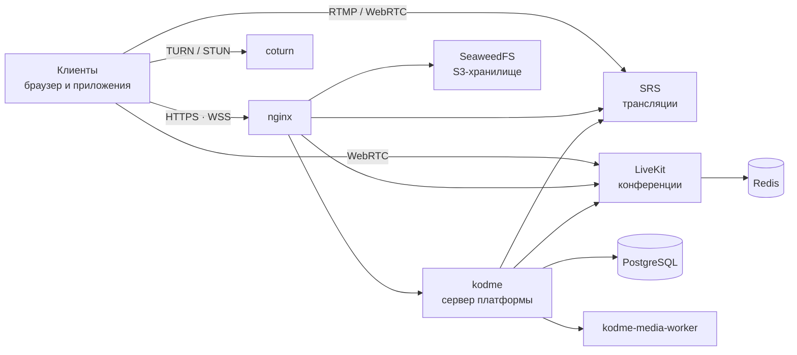

<div align="center">

# Kodme

### Самодостаточная платформа для общения, трансляций и работы

Мессенджер, сообщества, прямые эфиры и видеоконференции —
полностью на вашем сервере, под вашим контролем.

[](LICENSE)
[](#-быстрый-старт)
[](#-архитектура)
[](#-архитектура)
[](#-документация-api)

[**Возможности**](#-возможности) ·
[**Архитектура**](#-архитектура) ·
[**Быстрый старт**](#-быстрый-старт) ·
[**Конфигурация**](#-конфигурация) ·
[**Обновление**](#-обновление) ·
[**FAQ**](#-faq)

</div>

---

## 📖 О проекте

**Kodme** — платформа для общения и совместной работы, которую вы разворачиваете
у себя: на домашнем сервере, в офисе или в облаке. Все данные — переписка,
файлы, трансляции — хранятся на вашем оборудовании и не покидают ваш периметр.

В состав дистрибутива уже включён **веб-клиент**: после запуска платформа
готова к работе в браузере с любого устройства. Дополнительно доступны
десктопные и мобильные приложения.

- 🔐 **Приватность по умолчанию** — нет внешних зависимостей и телеметрии,
  ваши данные не передаются третьим лицам.
- 🧩 **Всё включено** — переписка, сообщества, звонки, трансляции, облако и
  боты работают сразу, «из коробки».
- 🚀 **Простое развёртывание** — один `git clone`, одна команда настройки и
  `compose up`. Никакой сборки исходников.

## ✨ Возможности

### 💬 Общение

- **Личные диалоги** — переписка один на один с реакциями, ответами и
  пересылкой сообщений.
- **Секретные чаты** — приватная переписка с шифрованием между устройствами
  собеседников (устройства сопоставляются через контакты).
- **Группы и темы** — групповые чаты с вложенными темами обсуждений.
- **Каналы** — публичные и приватные каналы-рассылки с постами, комментариями
  и ограничением права публикации.
- **Избранное и папки** — личное «облако сообщений» и удобная структура ленты.
- **Стикеры и стикерпаки** — свои наборы стикеров с публикацией в каталог.
- **Приглашения** — ссылки-инвайты для быстрого добавления в чаты и сообщества.

### 🎥 Медиа и звонки

- **Прямые трансляции** — эфиры через RTMP/WebRTC (SRS), чат трансляции,
  просмотр из клиента.
- **Видеоконференции** — групповые встречи на базе LiveKit с чатом и записью
  экрана.
- **P2P-звонки** — аудио- и видеозвонки по WebRTC с прохождением NAT через
  TURN/STUN.
- **Облачное хранилище** — личные файлы и избранное в S3-совместимом хранилище.
- **Обработка медиа** — превью изображений и видео, транскодинг, осциллограммы
  аудио (отдельный воркер, задачи через очередь).

### 🤖 Автоматизация и платформа

- **Боты** — полноценные боты и приложения поверх WebSocket API: команды,
  формы, автоматизация.
- **Кастомные темы оформления** — собственные темы клиента на CSS с
  собственным редактором.
- **Push-уведомления** — Web Push (VAPID), Firebase (FCM) и Huawei (HMS).
- **Публичное API** — HTTP и WebSocket API для кастомных клиентов и интеграций
  (подробная документация — в [`docs/api/`](docs/api/)).

### 🔒 Безопасность

- **2FA** — TOTP-коды и ключи доступа Passkey (WebAuthn).
- **Управление сессиями** — активные устройства, удалённый выход.
- **Защита от перебора и спама** — лимиты частоты HTTP-запросов и
  WebSocket-событий настраиваемы в конфигурации.
- **Сегментация сети** — база данных и кэш недоступны извне даже при
  компрометации точки входа.
- **Гибкие роли и модули** — модули платформы (каналы, звонки, трансляции,
  боты, регистрация) включаются и выключаются переключателями.

## 🧱 Архитектура

Платформа — набор контейнеров, описанных в `compose.yml`:



| Сервис | Образ | Назначение |
| --- | --- | --- |
| `nginx` | `nginx:alpine` | HTTPS, веб-клиент, проксирование API и медиа |
| `kodme` | `ghcr.io/bukreevlad/kodme` | сервер платформы (API, WebSocket, боты) |
| `kodme-media-worker` | `ghcr.io/bukreevlad/kodme` | обработка вложений (превью, транскодинг) |
| `db` | `postgres:18` | база данных платформы |
| `redis` | `redis:7` | кэш и координация LiveKit |
| `seaweedfs` | `seaweedfs` | объектное хранилище S3 (файлы, обложки, медиа) |
| `livekit`, `livekit-ingress` | `livekit/*` | видеоконференции, захват внешних потоков |
| `srs` | `ossrs/srs:6` | прямые трансляции (RTMP → WebRTC) |
| `coturn` | `coturn/coturn` | TURN/STUN для звонков и конференций |

Сети: `app` — приёмный сегмент (nginx и всё, к чему он проксирует);
`data` — сегмент данных (PostgreSQL, Redis), недоступный извне.

## 📋 Требования

- Linux-сервер (x86_64), 4 ГБ RAM и больше (при активных трансляциях — 8 ГБ).
- [Podman](https://podman.io) + `podman-compose` (или Docker — см. [FAQ](#-faq)).
- Домен с DNS-записями: основной (`example.com`) и поддомен для хранилища
  (`s3.example.com`), оба — на IP вашего сервера.

### Порты, которые нужно открыть

| Порт | Протокол | Назначение |
| --- | --- | --- |
| `80`, `443` | TCP | HTTPS (nginx) — в `compose.yml` по умолчанию `9080/9443`, см. [быстрый старт](#-быстрый-старт) |
| `1935` | TCP | RTMP — приём трансляций (SRS) |
| `8000` | TCP/UDP | WebRTC-трансляции (SRS) |
| `3478` | UDP | TURN (coturn) |
| `5349` | TCP | TURN over TLS (coturn) |
| `40000–49999` | UDP | relay-порты (coturn) |
| `50000–60000` | UDP | медиапотоки конференций (LiveKit) |
| `7881` | TCP | резервный транспорт медиа (LiveKit) |

Порты `7880` и `9090` (сигнал и метрики LiveKit) наружу **не** открываются —
клиенты подключаются через nginx.

## 🚀 Быстрый старт

> ⚠️ `setup.sh` выполняйте **до** первого запуска: пароль PostgreSQL
> применяется при первой инициализации базы данных.

```bash
# 1. Клонируйте репозиторий
git clone <адрес-этого-репозитория>
cd <папка-репозитория>

# 2. Настройте домен и сгенерируйте секреты
./setup.sh example.com

# 3. Выпустите TLS-сертификаты (см. ниже) и положите в nginx/ssl/example.com/

# 4. Запустите платформу
podman pull ghcr.io/bukreevlad/kodme:latest
podman-compose up -d
```

### 📜 TLS-сертификаты

nginx использует один сертификат на основной домен и S3-поддомен: файлы
`fullchain.pem` и `privkey.pem` в `nginx/ssl/<домен>/`. Пример выпуска через
certbot (порт 80 должен быть свободен — до запуска nginx):

```bash
sudo apt-get install certbot
sudo certbot certonly --standalone -d example.com -d s3.example.com

sudo mkdir -p nginx/ssl/example.com
sudo cp -L /etc/letsencrypt/live/example.com/fullchain.pem nginx/ssl/example.com/
sudo cp -L /etc/letsencrypt/live/example.com/privkey.pem nginx/ssl/example.com/
```

Для wildcard-сертификата используйте DNS-подтверждение владения доменом:
`sudo certbot certonly --manual --preferred-challenges dns -d "*.example.com" -d example.com`.

Certbot продлевает сертификаты автоматически — настройте hook/cron на копирование
обновлённых файлов в `nginx/ssl/` и перезапуск контейнера nginx.

### Первый запуск

1. **Проверьте конфигурацию** (при необходимости) в `kodme/config.yaml`:
   почта для писем, push-уведомления, список модулей.
2. **Откройте `https://example.com`**, зарегистрируйте аккаунт и добавьте его
   UUID в список администраторов (`server.administrators` в
   `kodme/config.yaml`), затем перезапустите сервер:
   `podman-compose up -d --no-deps --force-recreate kodme`.

Поздравляем — платформа работает! 🎉 Команды повседневного управления —
в [`Управление.md`](Управление.md).

## 🧩 Конфигурация

| Файл | Что настраивается |
| --- | --- |
| `kodme/config.yaml` | домен, почта (SMTP), push-уведомления, администраторы, включение модулей, лимиты, JWT |
| `nginx/conf.d/` | домены, маршруты и проксирование |
| `nginx/ssl/` | TLS-сертификаты (см. [«TLS-сертификаты»](#-tls-сертификаты)) |
| `srs/kodme.conf` | трансляции (RTMP/WebRTC) |
| `coturn/turnserver.conf` | TURN/STUN-сервер звонков |
| `livekit/livekit.yaml`, `livekit/ingress.yaml` | конференции и захват потоков |
| `compose.yml` | порты, лимиты памяти, состав сервисов |

### Связанные секреты

Часть секретов обязана совпадать в нескольких файлах (это отмечено
комментариями «ДУБЛИКАТ» рядом с каждым значением). Если меняете секрет
вручную — меняйте его везде:

| Плейсхолдер | Где встречается |
| --- | --- |
| `__DB_PASSWORD__` | `compose.yml` (`POSTGRES_PASSWORD`) ↔ `kodme/config.yaml` (`database.password`) |
| `__REDIS_PASSWORD__` | `compose.yml` (сервис `redis`) ↔ `livekit/livekit.yaml` ↔ `livekit/ingress.yaml` |
| `__S3_SECRET_KEY__` | `compose.yml` (`AWS_SECRET_ACCESS_KEY`) ↔ `kodme/config.yaml` (`s3.secretKey`) |
| `__TURN_SECRET__` | `kodme/config.yaml` (`server.web_rtc.secret`) ↔ `livekit/livekit.yaml` ↔ `coturn/turnserver.conf` |
| `__LIVEKIT_API_SECRET__` | `kodme/config.yaml` (`livekit.api_secret`) ↔ `livekit/livekit.yaml` (`keys.devkey`) ↔ `livekit/ingress.yaml` |
| `__JWT_USERS_SECRET__` | `kodme/config.yaml` (`jwt.users.secret`) |
| `__JWT_STORAGE_SECRET__` | `kodme/config.yaml` (`jwt.storage.secret`) |
| `__JWT_BROADCASTS_SECRET__` | `kodme/config.yaml` (`jwt.broadcasts.secret`) |
| `__SRS_API_SECRET__` | `kodme/config.yaml` (`srs.api_secret`) |

> 📌 TURN-секрет (`__TURN_SECRET__`) и секрет LiveKit (`__LIVEKIT_API_SECRET__`)
> обязаны быть **разными** значениями.

## 🔐 Секреты и безопасность

Скрипт `setup.sh` генерирует для каждого плейсхолдера своё случайное значение
(`openssl rand -hex 32`) — секреты вашей установки уникальны и не совпадают
ни с какой другой.

Если настраиваете секреты вручную или ротируете их:

- генерируйте новое значение: `openssl rand -hex 32`;
- соблюдайте связки из таблицы выше;
- помните: пароль БД (`POSTGRES_PASSWORD`) меняется только вместе с
  переинициализацией базы — для работающей установки потребуется
  `ALTER USER` в PostgreSQL.

Рекомендуется дополнительно:

- не открывайте наружу порты, не перечисленные в [таблице портов](#порты-которые-нужно-открыть);
- ограничьте SSH доступом по ключу;
- регулярно обновляйте образ (`podman pull`) — см. [Обновление](#-обновление).

## 🔄 Обновление

```bash
git pull
podman pull ghcr.io/bukreevlad/kodme:latest
podman-compose up -d --no-deps --force-recreate kodme kodme-media-worker
```

Важные моменты:

- **Ваши локальные правки** (секреты, домен, настройки) живут в тех же файлах,
  что и файлы репозитория. Чтобы `git pull` не конфликтовал, зафиксируйте свои
  правки локальным коммитом (или `git stash`) и переносите их в обновлённые
  файлы. При конфликте сохраняйте свои значения секретов и домена.
- Если обновление затронуло `compose.yml` или конфиги сервисов —
  пересоздайте соответствующие контейнеры (`--force-recreate`), а не только
  перезапускайте.
- Запускайте `./setup.sh` только один раз, при первичной настройке: повторный
  запуск не требуется и не перегенерирует уже настроенные секреты.

## 📦 Образ сервера

Образ платформы публикуется в GitHub Container Registry и скачивается **без
авторизации**:

```bash
podman pull ghcr.io/bukreevlad/kodme:latest
```

Запасной реестр — `registry.kodme.ru` (тоже без авторизации). Если GHCR
недоступен, подтяните образ оттуда и перетегируйте под имя из `compose.yml`:

```bash
podman pull registry.kodme.ru/kodme:latest
podman tag registry.kodme.ru/kodme:latest ghcr.io/bukreevlad/kodme:latest
```

Резервный путь на случай недоступности обоих реестров — архив `kodme.tar.gz`
со [страницы загрузок](https://kodme.ru):

```bash
podman load -i kodme.tar.gz
podman tag localhost/kodme:latest ghcr.io/bukreevlad/kodme:latest
podman-compose up -d
```

## 📚 Документация API

Для разработки собственных клиентов и интеграций — HTTP и WebSocket API
платформы:

- 📂 [`docs/api/`](docs/api/) — полная документация в этом репозитории;
- 🌐 [kodme.ru/docs/api](https://kodme.ru/docs/api) — то же онлайн.

Документация описывает аутентификацию, события, объекты, коды ошибок и
ограничения — всё, что нужно для написания кастомного клиента или бота.

## ❓ FAQ

<details>
<summary><b>Почему setup.sh нужно запускать до первого запуска?</b></summary>

Пароль PostgreSQL задаётся при первой инициализации базы данных (initdb) и
позже автоматически не меняется. Если запустить стенд до генерации секретов,
база создастся с пустым паролем, и потребуется ручное исправление.
</details>

<details>
<summary><b>Можно ли использовать Docker вместо Podman?</b></summary>

Да, `compose.yml` совместим с Docker Compose, за одним исключением: опция
`userns: "keep-id"` в сервисах `kodme` и `kodme-media-worker` специфична для
Podman. Для Docker удалите эту строку (права на файлы будет выставлять
контейнер от root).
</details>

<details>
<summary><b>Первый запуск: образ kodme не скачивается.</b></summary>

Образ тянется из `ghcr.io/bukreevlad/kodme` без авторизации. Если реестр временно
недоступен — используйте запасной `registry.kodme.ru` или резервный путь
с `kodme.tar.gz` (см. [«Образ сервера»](#-образ-сервера)) и повторите
`podman-compose up -d`.
</details>

<details>
<summary><b>Как сменить домен после первичной настройки?</b></summary>

Замените старый домен во всех конфигах (см. [«Конфигурация»](#-конфигурация)),
перевыпустите сертификаты, при необходимости укажите `security.webauthn.origin`
в `kodme/config.yaml` и пересоздайте контейнеры. Учтите, что `setup.sh`
предназначен только для первичной настройки.
</details>

<details>
<summary><b>Как сделать резервную копию?</b></summary>

Данные платформы — это база PostgreSQL и объектное хранилище. Бэкап базы и
восстановление описаны в [`Управление.md`](Управление.md); папки
`seaweedfs/data/`, `redis/data/`, `nginx/ssl/` сохраняйте вместе с бэкапом
базы.
</details>

## 📄 Лицензия

Файлы этого репозитория (конфигурации, скрипты развёртывания и документация)
распространяются по лицензии [MIT](LICENSE).

Образы сервера платформы «Код.me» и клиентские приложения в состав репозитория
**не входят** и распространяются на отдельных условиях.

Программное обеспечение предоставляется «как есть», без каких-либо гарантий.
Авторы не несут ответственности за любые ущербы и последствия, возникшие
в результате использования.

---

<div align="center">

**[kodme.ru](https://kodme.ru)** — официальный сайт платформы

</div>
